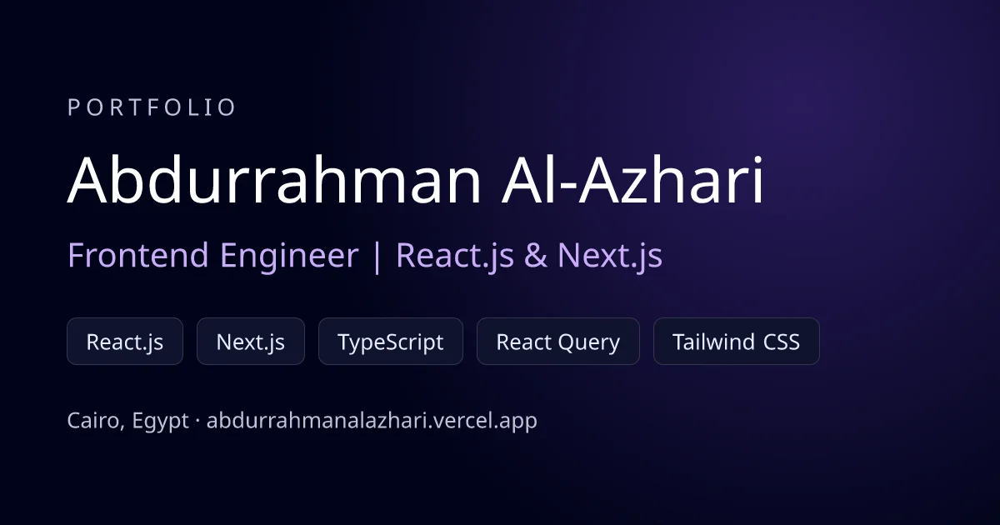

<div align="center">

<a href="https://abdurrahmanalazhari.vercel.app">
  
</a>

# Abdurrahman Al-Azhari — Portfolio

**Frontend Engineer · React.js & Next.js · Cairo, Egypt**

[**Live site**](https://abdurrahmanalazhari.vercel.app) · [النسخة العربية](https://abdurrahmanalazhari.vercel.app/ar) · [Online CV](https://abdurrahmanalazhari.vercel.app/cv) · [LinkedIn](https://www.linkedin.com/in/abdolrahman-alazhary)

[](https://github.com/Abdomahmoudgit/Abdurrahman-Alazhari-Portfolio/actions/workflows/ci.yml)

</div>

---

My personal portfolio: a fast, bilingual (English / Arabic) site with a light and dark theme, detail pages for each project, an AI assistant that answers questions about my work, a printable online CV, a blog and a working contact form — all tested in CI.

## Features

- **English + Arabic** — `/` and `/ar`, with a full right-to-left layout, an Arabic font and translated content. `hreflang` links connect the two versions.
- **Dark and light mode** — dark by default; the choice is saved. All colors come from theme tokens, so every section works in both.
- **AI assistant** — a chat widget that answers visitors' questions about my experience and projects using Claude (streamed answers, prompt-cached system prompt built from the site data, input limits and rate limiting), with a WhatsApp hand-off for hiring questions.
- **Project pages** — `/projects/[slug]` (and `/ar/projects/[slug]`) with an overview, my role, key features, the tech stack and live / GitHub links. They're statically generated.
- **Online CV** — `/cv` and `/ar/cv`, generated from the same data as the site and styled to print as a clean A4 PDF.
- **Blog** — MDX articles in both languages (`/blog`), with drafts that only show in development.
- **Contact form** — sends messages straight to my inbox through Web3Forms, with spam protection.
- **Performance** — no animation library: every effect is CSS, heavy 3D loads only when needed, WebP images through `next/image`, self-hosted fonts. First-load JS 125 kB.
- **SEO** — per-page metadata, a generated Open Graph share image, a sitemap with language alternates, robots.txt, and JSON-LD `Person` data.
- **Accessible** — one `<h1>` per page, labeled controls, reduced-motion support and good contrast in both themes.

### Lighthouse (mobile)

| Page | Performance | Accessibility | Best Practices | SEO |
| --- | :---: | :---: | :---: | :---: |
| English `/` | 93–95 | 100 | 96 | 100 |
| Arabic `/ar` | 91–95 | 100 | 96 | 100 |

## Tech stack

**Next.js 14 (App Router)** · **React 18** · **TypeScript** · **Tailwind CSS** · Claude API (`@anthropic-ai/sdk`) · MDX (next-mdx-remote) · Three.js / React Three Fiber · next-themes · Web3Forms · Vitest · Playwright · GitHub Actions · Vercel (hosting, Analytics, Speed Insights)

## Getting started

```bash
git clone https://github.com/Abdomahmoudgit/Abdurrahman-Alazhari-Portfolio.git
cd Abdurrahman-Alazhari-Portfolio
npm install
cp .env.example .env.local   # add ANTHROPIC_API_KEY to enable the AI assistant
npm run dev        # http://localhost:3000  (Arabic: /ar)
```

Other commands:

```bash
npm run build      # production build
npm run start      # serve the build
npm run lint
npx tsc --noEmit   # type-check
```

## Testing

```bash
npm test           # unit tests (Vitest): content integrity, chat validation, blog posts
npm run build && npm run test:e2e   # end-to-end tests (Playwright) against the production build
```

The end-to-end suite checks both languages, the theme toggle, every page in the sitemap, phone layouts (no horizontal scroll), the CV page, the contact form and the chat widget. The contact form and the chat API are mocked, so tests never send real emails or AI requests. GitHub Actions runs lint, type-check, unit tests, build and the Playwright suite on every push and pull request.

## Project structure

```
app/
  (en)/                English root layout, home, /projects, /cv, /blog
  (ar)/ar/             Arabic root layout (RTL), same pages under /ar
  _shell.tsx           shared <html>/<body>, theme provider, analytics
  api/chat/route.ts    AI assistant endpoint (Claude, streaming)
  og/route.tsx         generated share image (/og)
  sitemap.ts, robots.ts
components/            page sections (Hero, Projects, Experience, Skills, ChatWidget, CvPage, ...)
components/ui/         animated building blocks (bento grid, globe, navbar, ...)
content/blog/{en,ar}/  blog posts (MDX)
data/
  en.ts, ar.ts         all site text, one file per language
  shared.ts            links, images and settings shared by both languages
lib/                   metadata, blog, CV, chat validation and assistant prompt
tests/unit, tests/e2e  Vitest and Playwright suites
public/                images, icons and the CV PDF
```

### Editing content

All text lives in **`data/en.ts`** and **`data/ar.ts`**, which have the same shape (see `data/types.ts`). Links, image paths and the contact-form key are in `data/shared.ts`. Components only render what they receive, so you don't need to touch them to change the content — the online CV and the AI assistant update automatically from the same data.

To publish a blog post, add `content/blog/en/<slug>.mdx` and `content/blog/ar/<slug>.mdx` and set `draft: false` in both.

## Credits

The original design is based on the [JavaScript Mastery](https://www.youtube.com/@javascriptmastery) "Modern Next.js Portfolio" tutorial. I extended it with my own content and added the bilingual setup, theming, project pages, AI assistant, online CV, blog, contact form, tests and CI, performance work and SEO.

## Contact

- Email: [abdolrahmanalazhary@gmail.com](mailto:abdolrahmanalazhary@gmail.com)
- LinkedIn: [abdolrahman-alazhary](https://www.linkedin.com/in/abdolrahman-alazhary)
- GitHub: [Abdomahmoudgit](https://github.com/Abdomahmoudgit)
